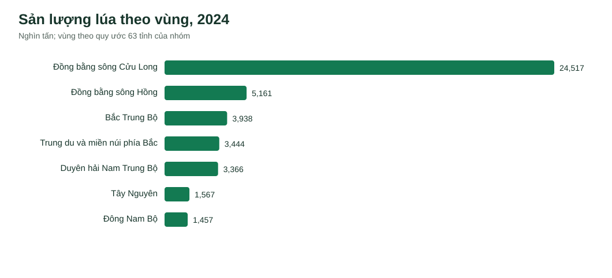
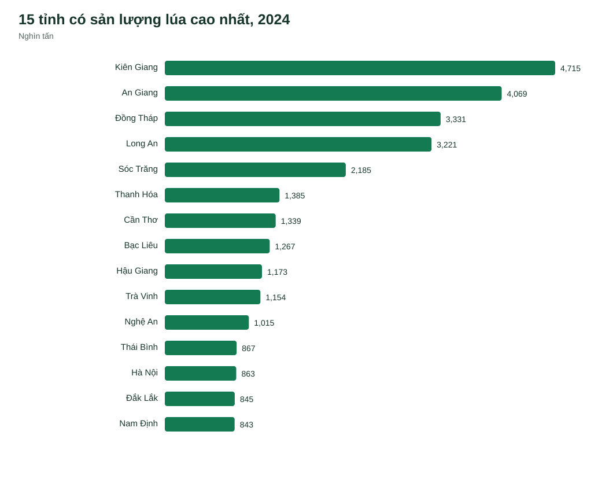
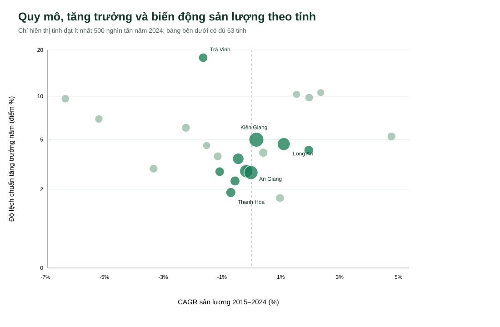

# BP1 — Đánh giá vùng thu mua lúa

Đây là phần phân tích bổ sung với các hình tĩnh năm 2024. Báo cáo chính: [Word tiếng Việt](BP1_Danh_gia_vung_thu_mua_lua.docx) và [Word tiếng Anh](BP1_Rice_Sourcing_Regions.docx). Cách dùng bốn biểu đồ Streamlit và các bộ lọc được mô tả tại [hướng dẫn BP1](../../docs/bp1.md). Các hình tĩnh dưới đây có bố cục riêng; biểu đồ bong bóng tĩnh dùng trục ngang CAGR, trục dọc biến động, khác cách đặt trục trên dashboard trực tiếp.

## 1. Câu hỏi và phạm vi

Doanh nghiệp chế biến, thu mua lúa cần biết tỉnh nào có **quy mô sản xuất lớn**, xu hướng sản lượng ra sao và mức biến động lịch sử thế nào để chọn nơi khảo sát nhà cung cấp. Kết quả BP1 là danh sách ưu tiên khảo sát, không phải xếp hạng nhà cung cấp hay lượng lúa thực tế có thể mua.

Phân tích dùng 63 tỉnh/thành theo địa giới trong số liệu 2010–2024. Năm mới nhất của bản dữ liệu này là **2024**. Bảy vùng theo file `vietnam_regions_provinces.json` nhóm cung cấp; đây là cách chia phục vụ dashboard. Nguồn NSO gộp Bắc Trung Bộ và Duyên hải miền Trung thành một vùng, nên toàn bộ số vùng ở đây được **tính lại từ dòng tỉnh**, không lấy trực tiếp dòng vùng NSO.

## 2. Dữ liệu và cách tính

Ba bảng Cục Thống kê (NSO) PX-Web: [V06.13, diện tích gieo trồng lúa cả năm](https://pxweb.nso.gov.vn/pxweb/vi/N%C3%B4ng%20nghi%E1%BB%87p%2C%20l%C3%A2m%20nghi%E1%BB%87p%20v%C3%A0%20th%E1%BB%A7y%20s%E1%BA%A3n/N%C3%B4ng%20nghi%E1%BB%87p%2C%20l%C3%A2m%20nghi%E1%BB%87p%20v%C3%A0%20th%E1%BB%A7y%20s%E1%BA%A3n/V06.13.px/), [V06.14, năng suất lúa cả năm](https://pxweb.nso.gov.vn/pxweb/vi/N%C3%B4ng%20nghi%E1%BB%87p%2C%20l%C3%A2m%20nghi%E1%BB%87p%20v%C3%A0%20th%E1%BB%A7y%20s%E1%BA%A3n/N%C3%B4ng%20nghi%E1%BB%87p%2C%20l%C3%A2m%20nghi%E1%BB%87p%20v%C3%A0%20th%E1%BB%A7y%20s%E1%BA%A3n/V06.14.px/) và [V06.15, sản lượng lúa cả năm](https://pxweb.nso.gov.vn/pxweb/vi/N%C3%B4ng%20nghi%E1%BB%87p%2C%20l%C3%A2m%20nghi%E1%BB%87p%20v%C3%A0%20th%E1%BB%A7y%20s%E1%BA%A3n/N%C3%B4ng%20nghi%E1%BB%87p%2C%20l%C3%A2m%20nghi%E1%BB%87p%20v%C3%A0%20th%E1%BB%A7y%20s%E1%BA%A3n/V06.15.px/). Bản gốc 2010–2024 được lưu trong `data/raw/` để nhóm có thể chạy lại. Đơn vị lần lượt là **nghìn ha**, **tạ/ha**, **nghìn tấn**. Dữ liệu được ghép bằng tỉnh và năm; không cộng trực tiếp năng suất.

Chỉ số so sánh:

| Chỉ số | Công thức và ý nghĩa |
|---|---|
| Quy mô | Sản lượng lúa năm 2024, nghìn tấn. |
| Tỷ trọng | Sản lượng tỉnh hoặc vùng / tổng sản lượng 63 tỉnh năm 2024. |
| CAGR | `(sản lượng 2024 / sản lượng 2015)^(1/9) − 1`. Đây là xu hướng từ điểm đầu đến điểm cuối, không bảo đảm tăng đều từng năm. |
| Biến động | Độ lệch chuẩn mẫu của 9 tỷ lệ tăng trưởng năm 2016–2024, đơn vị **điểm phần trăm**. Giá trị nhỏ nghĩa là tăng trưởng hằng năm ít dao động hơn trong giai đoạn này. |
| Mức giảm sâu nhất | Tỷ lệ thay đổi năm âm nhất trong 2016–2024; giúp thấy một năm bất lợi đã xảy ra. |

Quy mô dùng năm gần nhất, còn CAGR và biến động dùng 2015–2024 để có một thập kỷ gần đây. Các chỉ số là **mô tả lịch sử**, không dự báo xác suất thiếu hàng. Độ lệch chuẩn tỷ lệ tăng trưởng của tỉnh có nền sản lượng rất nhỏ thường lớn; luôn đọc cùng quy mô tuyệt đối.

## 3. Diễn giải biểu đồ

### Hình 1 — Sản lượng theo vùng năm 2024

Tổng 63 tỉnh đạt **43,45 triệu tấn**. Đồng bằng sông Cửu Long có **24,52 triệu tấn**, tương đương **56,4%**; đây là vùng đầu tiên nên khảo sát mạng lưới thu mua vì quy mô vượt xa các vùng còn lại. Đồng bằng sông Hồng đứng thứ hai (**5,16 triệu tấn; 11,9%**), Bắc Trung Bộ thứ ba (**3,94 triệu tấn; 9,1%**). Sự tập trung ở Đồng bằng sông Cửu Long giúp lập kế hoạch thu mua lớn nhưng cũng cho thấy doanh nghiệp cần xem xét mức phụ thuộc vào một vùng. Biểu đồ không cho biết phần sản lượng đã được hợp đồng hóa hay mức phù hợp về giống lúa và chất lượng.

Bảng 7 vùng trên dashboard bổ sung xu hướng và biến động: Đồng bằng sông Cửu Long giảm nhẹ theo CAGR **−0,47%/năm**, độ biến động tăng trưởng **3,39 điểm %**. Đồng bằng sông Hồng giảm rõ hơn (**−2,56%/năm**), nên sản lượng năm 2024 của vùng này không nên được kéo thẳng thành kỳ vọng tương lai. Bắc Trung Bộ tăng nhẹ (**0,37%/năm**). Tây Nguyên tăng nhanh nhất trong 7 vùng (**2,92%/năm**) nhưng chỉ chiếm **3,6%** sản lượng cả nước, nên không thể thay thế quy mô của Đồng bằng sông Cửu Long trong ngắn hạn. Biến động của tổng vùng có thể thấp hơn biến động của từng tỉnh do các thay đổi bù trừ nhau.

### Hình 2 — 15 tỉnh sản lượng lớn nhất năm 2024

**Kiên Giang** dẫn đầu với **4,71 triệu tấn**, chiếm **10,85%** cả nước; sau đó là **An Giang 4,07 triệu**, **Đồng Tháp 3,33 triệu** và **Long An 3,22 triệu tấn**. Bốn tỉnh này đều thuộc Đồng bằng sông Cửu Long, thích hợp làm nhóm địa bàn khởi đầu để tìm đối tác. Tuy nhiên, riêng quy mô 2024 chưa đủ để chọn giữa họ: Long An tăng sản lượng theo CAGR **1,10%/năm**, còn An Giang gần như đi ngang (**−0,01%/năm**) trong 2015–2024. Ở ngoài Đồng bằng sông Cửu Long, **Thanh Hóa** là tỉnh có quy mô lớn nhất (**1,38 triệu tấn**), đáng xem như địa bàn khảo sát bổ sung để đa dạng hóa địa lý.

### Hình 3 — Quy mô, tăng trưởng và biến động cấp tỉnh

Trục ngang là CAGR sản lượng 2015–2024; càng về bên phải là tăng trưởng dài hạn càng cao. Trục dọc là độ lệch chuẩn tăng trưởng từng năm; càng thấp là lịch sử ít dao động hơn. Để tập trung vào các nguồn có quy mô đáng kể, biểu đồ chỉ hiển thị tỉnh đạt **từ 500 nghìn tấn năm 2024**, còn bảng dashboard giữ đủ 63 tỉnh. Trục dọc dùng **thang logarit**; khoảng cách dọc không tuyến tính. Diện tích vòng tròn phản ánh quy mô 2024; nhãn nêu các tỉnh có sản lượng cao. **An Giang** và **Đồng Tháp** kết hợp quy mô lớn (4,07 và 3,33 triệu tấn) với biến động tăng trưởng tương đối thấp (**2,79 và 2,87 điểm %**). Đây là hai địa bàn hợp lý để khảo sát nguồn cung ổn định về mặt thống kê, dù sản lượng có xu hướng gần như đi ngang hoặc giảm nhẹ. **Kiên Giang** lớn hơn nhưng độ biến động **5,00 điểm %**; kế hoạch thu mua ở đây nên xem xét các năm giảm sản lượng, không chỉ năm 2024.

**Long An** có quy mô lớn, CAGR dương **1,10%**, nhưng biến động **4,64 điểm %**, nên là ứng viên tăng trưởng kèm nhu cầu dự phòng. **Trà Vinh** vẫn đạt **1,15 triệu tấn** năm 2024 nhưng có độ biến động **17,86 điểm %**; các đợt giảm **28,6% năm 2016** và **25,4% năm 2020** làm chỉ số cao. Cần tìm hiểu dữ liệu mùa vụ và nguyên nhân biến động trước khi xem đây là nguồn cung thường xuyên. **Bến Tre** nằm ngoài ngưỡng hiển thị của biểu đồ vì sản lượng lúa nhỏ, nhưng vẫn có trong bảng 63 tỉnh. Phần trăm biến động của tỉnh này rất cao do nền sản lượng nhỏ; không nên so trực tiếp con số % đó với các tỉnh sản lượng hàng triệu tấn.

## 4. Hàm ý cho kế hoạch thu mua

1. **Khảo sát chính:** Kiên Giang, An Giang, Đồng Tháp, Long An. Đây là nhóm quy mô rất lớn; ưu tiên kiểm tra doanh nghiệp cung cấp, giống/chất lượng, giá và khả năng vận chuyển.
2. **Nguồn bổ sung:** Thanh Hóa và các tỉnh khác ngoài Đồng bằng sông Cửu Long để giảm tập trung địa lý. Thanh Hóa có biến động tăng trưởng **1,87 điểm %** nhưng CAGR **−0,70%**, nên cần kiểm tra xu hướng suy giảm trước khi kỳ vọng nguồn cung tăng.
3. **Theo dõi chặt:** Trà Vinh có các cú giảm lớn; Kiên Giang và Long An có biến động cao hơn An Giang, Đồng Tháp. Đưa các địa bàn này vào kịch bản dự phòng và xác minh thực tế ở cấp nhà cung cấp.

BP1 chỉ dùng sản lượng sản xuất làm đại diện cho **tiềm năng nguồn cung**. Quyết định mua hàng cần thêm lượng lúa hàng hóa, mạng lưới thương lái/doanh nghiệp, giá, chủng loại, chất lượng, thời điểm thu hoạch, kho và vận tải. Không suy nguyên nhân biến động từ các biểu đồ mô tả này; BP2 và BP4 xử lý các câu hỏi giải thích riêng.

## 5. Kiểm tra dữ liệu và giới hạn

Có đủ **945 dòng tỉnh-năm (63 × 15)**, không thiếu một trong ba chỉ tiêu. Tổng sản lượng 63 tỉnh khớp dòng cả nước của V06.15 ở từng năm trong sai số tính toán. Năm 2024 là **43.451,56 nghìn tấn**. Diện tích × năng suất / 10 gần bằng sản lượng nhưng có sai khác nhỏ do các số công bố đã làm tròn; dùng sản lượng V06.15 làm chỉ số chính.

Quy ước 7 vùng và địa giới 63 tỉnh thuộc giai đoạn dữ liệu, không phải địa giới hành chính sau sắp xếp năm 2025. Khi bổ sung dữ liệu mới, nhóm cần bảng đối chiếu địa giới trước khi so sánh nối chuỗi. CAGR nhạy với hai năm đầu-cuối; độ biến động 9 quan sát năm còn ngắn và không phải thước đo bảo đảm rủi ro tương lai.
